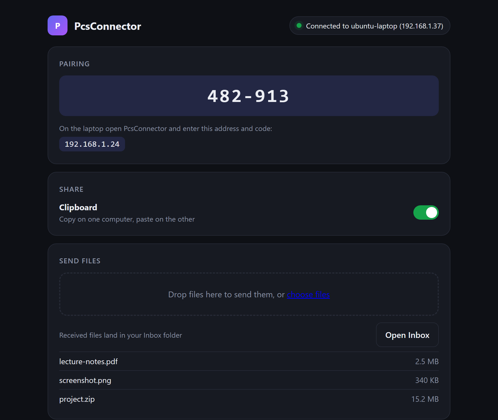

# PcsConnector

Use an **Ubuntu laptop as an extended screen for a Windows PC**, with shared mouse/keyboard, clipboard and file transfer.

<p align="center"></p>

Written in **Go**: one ~7 MB static binary per OS, ~10 MB RAM idle, nothing to install at runtime. The app window is a built-in local web page (no Electron).

| Feature | How | Status |
|---|---|---|
| Clipboard sync (text) | `pcsc`, encrypted TCP; event-driven on Windows | ✅ working (Windows side verified) |
| File transfer | `pcsc` – drop into `Outbox`, appears in peer's `Inbox` | ✅ working (loopback tested) |
| Mouse + keyboard sharing | [Deskflow](https://github.com/deskflow/deskflow) now; native later | 📄 documented, not built |
| Extended screen | Built-in: one-click virtual monitor + JPEG stream to Ubuntu, no ffmpeg | 🧪 built, untested on real hardware |
| App window | Pairing code, drag-and-drop files, clipboard toggle, screen start/stop | ✅ working |

> Input Leap is archived (last release June 2025) – use Deskflow, which is actively maintained.

Docs: [setup](docs/SETUP.md) · [architecture & roadmap](docs/ARCHITECTURE.md)

## Quick start

Build (needs Go): `./build.ps1` → `dist/PcsConnector.exe` (Windows app) and `dist/pcsconnector-ubuntu.tar.gz` (Ubuntu bundle).

1. **Windows:** double-click `PcsConnector.exe` → "This is the Windows PC". It shows a pairing code and your PC's address. Allow it through the firewall if asked.
2. **Ubuntu:** copy the tarball over, then
   ```bash
   tar xzf pcsconnector-ubuntu.tar.gz && bash pcsconnector-ubuntu/install.sh
   ```
   Open **PcsConnector** from the app menu → "This is the laptop" → enter the address + code.
3. Done: clipboard syncs, drag files into the window to send them, and press "Set up virtual monitor" once, then "Start extended screen" shows it on the laptop.

CLI is still available (`pcsc host`, `pcsc join <ip> --token T`, `pcsc doctor`). `go test ./...` runs the tests. Full steps: [docs/SETUP.md](docs/SETUP.md).

## Security

Frames are AES-256-GCM encrypted with a key derived (scrypt) from the shared token; a wrong token can't connect. No replay protection or forward secrecy yet – use on a trusted LAN or VPN, never expose port 24800 to the internet.

## License
MIT
