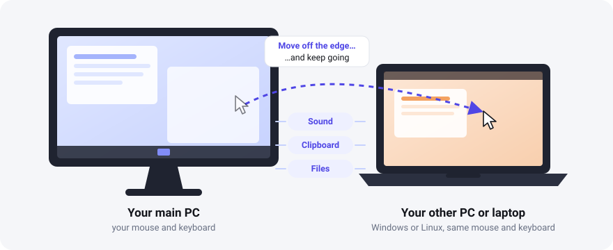
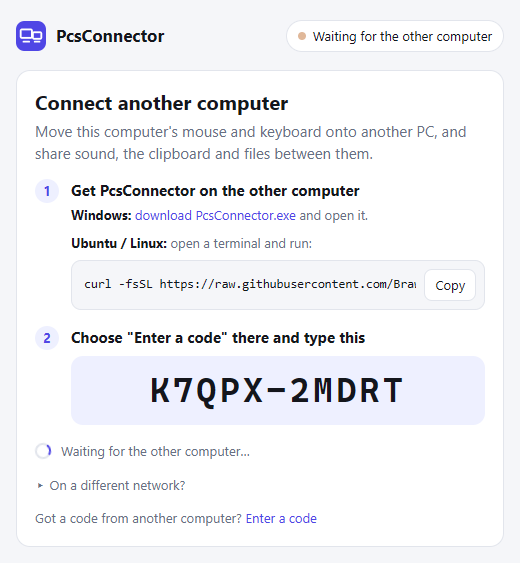
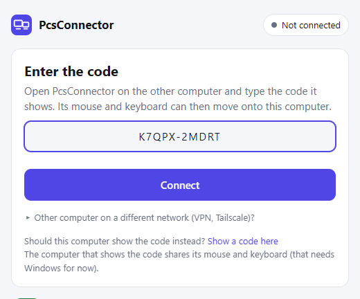
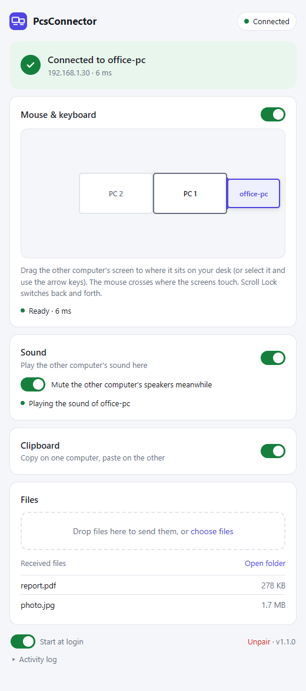
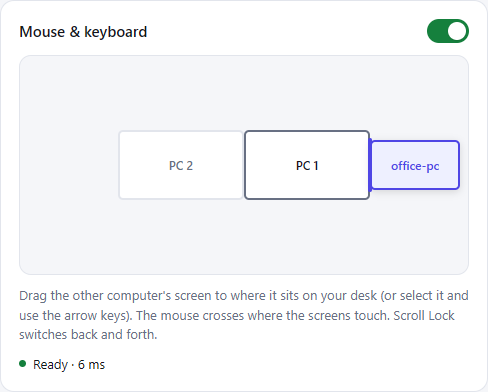
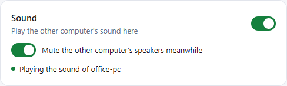
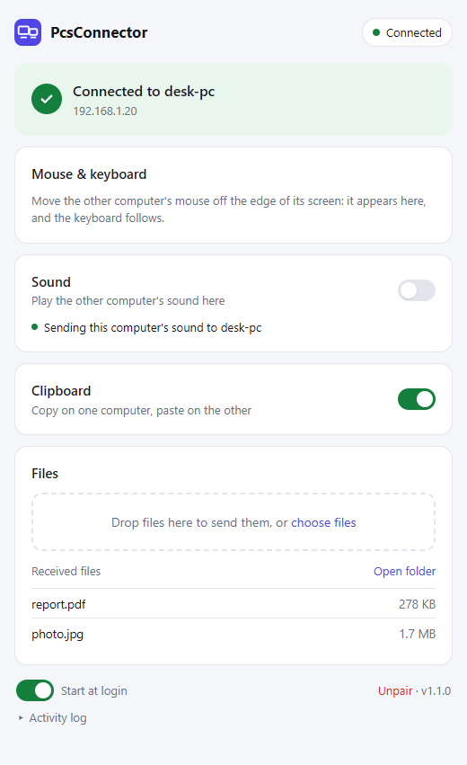

<h1 align="center">PcsConnector</h1>

<p align="center"><b>Connect all your PCs together in one setup.</b><br>
Move your mouse off the edge of one screen and it carries on onto the next computer. The keyboard follows, and sound, the clipboard and files are shared between them.</p>

<p align="center">
  <a href="https://github.com/Brawly0/PcsConnector/releases/latest"></a>
  
  <a href="LICENSE"></a>
</p>

<p align="center"></p>

## What it does

| | |
|---|---|
| 🖱️ **One mouse and keyboard** | Push the mouse off the edge of your screen and it moves onto the other computer. Everything you type goes there too. Works like Input Leap or Synergy, without the setup. **Scroll Lock** jumps back and forth. |
| 🖥️ **Your screens, your layout** | Drag the other computer's screen to wherever it sits on your desk: left, right, above or below any of your monitors. The mouse crosses exactly where the screens touch. |
| 🔊 **Sound** | Hear the other computer through this one's speakers or headphones. Its own speakers go quiet meanwhile. One switch turns it on or off. |
| 📋 **Shared clipboard** | Copy on one computer, paste on the other. |
| 📁 **File transfer** | Drop files into the window and they appear on the other computer. |

It is one small program on each computer (about 7 MB, about 10 MB of RAM). Nothing else to install on Windows, and no account or cloud: the computers talk directly over your network, encrypted.

### Works between

| From → to | Mouse & keyboard | Sound, clipboard, files |
|---|:-:|:-:|
| Windows → Windows | ✅ | ✅ |
| Windows → Linux | ✅ | ✅ |
| Linux → Windows | use Windows as the main PC | ✅ |
| Linux → Linux | not yet | ✅ |

The computer that **shows the code** shares its mouse and keyboard; the one that **enters the code** is controlled. For now the computer sharing its mouse needs to run Windows.

## Get started

It takes about two minutes. Both computers need to be on the same network.

<table>
<tr>
<td width="50%" valign="top">

### 1. On your main PC

This is the computer whose mouse and keyboard you'll use. Download **[PcsConnector.exe](https://github.com/Brawly0/PcsConnector/releases/latest/download/PcsConnector.exe)** and double-click it. It shows a pairing code.

- *"Windows protected your PC"*? Click **More info → Run anyway**. (The app isn't code-signed yet.)
- Firewall prompt? Click **Allow**.

</td>
<td width="50%" valign="top"></td>
</tr>
<tr>
<td valign="top">

### 2. On the other computer

**Windows:** download the same **[PcsConnector.exe](https://github.com/Brawly0/PcsConnector/releases/latest/download/PcsConnector.exe)**, open it, and click **Enter a code** at the bottom.

**Ubuntu / Linux:** open a terminal, paste this, and type your password when asked:

```bash
curl -fsSL https://raw.githubusercontent.com/Brawly0/PcsConnector/main/install/install.sh | bash
```

Then **type the code from your main PC and press Connect.** It finds the main PC on your network by itself, so there are no IP addresses to type.

</td>
<td valign="top"></td>
</tr>
<tr>
<td valign="top">

### 3. Done

Both windows turn green. From now on the computers reconnect by themselves, even after a restart.

On the main PC, drag the other computer's screen to where it sits next to your monitors. Then move the mouse off that edge.

</td>
<td valign="top">
<picture>
  <source media="(prefers-color-scheme: dark)" srcset="docs/images/app-connected-dark.png">
  
</picture>
</td>
</tr>
</table>

> **Not on the same network?** Over a VPN such as Tailscale, the computers can't find each other by themselves. On the computer entering the code, open *"Other computer on a different network?"* and type one of the addresses the main PC lists under *"On a different network?"*.

## Using it

<table>
<tr>
<td width="50%" valign="top">

**Screen layout.** The main PC's window shows your monitors and the other computer's screen. Drag it into place, or select it and use the arrow keys. It snaps to the nearest edge, and a highlight shows where the mouse crosses.

**Mouse & keyboard.** Move off that edge to go to the other computer, and back to return. **Scroll Lock** jumps between them. While you're on the other computer, the main PC's cursor hides. You can't cross while holding a mouse button, so dragging near the edge is safe.

</td>
<td width="50%" valign="top"></td>
</tr>
<tr>
<td valign="top">

**Sound.** Turn on **Sound** in the window of the computer you want to *hear* on. Whatever the other computer plays then comes out of this one, and the other computer's speakers are muted (untick *"Mute the other computer's speakers meanwhile"* to keep both). Turn the same switch off to stop; it remembers your choice. One direction at a time. It uses about 1.5 Mbit/s while something plays, nothing when it's silent.

</td>
<td valign="top"></td>
</tr>
<tr>
<td valign="top">

**On the other computer** the window shows what's connected and lets you turn sound, the clipboard and files on or off from that side too.

- **Clipboard:** on by default; switch it off in the window.
- **Files:** drop files into the window, or use *choose files*. They arrive in the other computer's `PcsConnector/Inbox` folder.
- **Start at login** (bottom of the window): keep it on so a restart reconnects by itself.
- **Unpair** (bottom of the window): forgets the pairing. The main PC then shows a new code.

</td>
<td valign="top"></td>
</tr>
</table>

**Lag tip:** the main PC's window shows the round trip to the other computer. Under about 20 ms feels local. If it spikes, it's almost always Wi-Fi: Ethernet or 5 GHz Wi-Fi makes the biggest difference.

## Troubleshooting

| Problem | What to do |
|---|---|
| It says *"Looking for the other computer…"* and never connects | Check that PcsConnector is open on the main PC with the same code and that both are on the same network. If Windows asked about the firewall, it must be allowed on both. On a VPN, enter the main PC's address instead. |
| The mouse doesn't move onto the other computer | Check where its screen sits in the layout on the main PC. On Linux, open the PcsConnector window there once after it starts (that's how the main PC learns its screen size), and `pcsc doctor` should report `/dev/uinput writable`; if not, run the installer again. |
| On a Windows PC being controlled, some windows ignore the mouse or keyboard | Windows doesn't let normal apps control windows running as administrator (Task Manager, installers). Run PcsConnector as administrator on that PC if you need those. |
| The window says *"slow path"* | The other computer's firewall blocks UDP 24800. On Ubuntu run `sudo ufw allow 24800/udp`; on Windows allow PcsConnector when asked. |
| No sound from the other computer | Check that **Sound** is on in the window where you want to hear it, and that something is playing on the other computer. On Linux, `pcsc doctor` should report `sound sharing: pw-cat` (or `pacat`). The window shows a message if a side can't play or record. |
| The clipboard doesn't sync | On Linux run `pcsc doctor`. It needs `wl-clipboard` (Wayland) or `xclip` (X11), which the installer adds. |

The window's **Activity log** usually says what's wrong. On Linux there's also `/tmp/pcsc.log`. More in [docs/SETUP.md](docs/SETUP.md).

## Requirements

- **Windows:** Windows 10 or 11, 64-bit. The window uses Edge, which Windows already has, or Chrome.
- **Linux:** Ubuntu 22.04 or newer, or another systemd-based Linux desktop. Wayland or X11, amd64 or arm64. Sound uses PipeWire (`pw-cat`) or PulseAudio (`pacat`), which Ubuntu already has.
- **Network:** both on the same network, or connected through a VPN. Uses port 24800 (TCP and UDP).

## Privacy & security

- No accounts, no cloud, no telemetry. The computers talk only to each other.
- The pairing code is the key. Everything sent between the computers is encrypted and authenticated (AES-256-GCM, with the key derived from the code using scrypt). A computer without the code can't connect, read anything, or even get an answer when it searches the network.
- The window's control page only listens on `127.0.0.1`.
- Not yet included: forward secrecy and replay protection. Use it on your own network or a VPN, and don't expose port 24800 to the internet.

## Build from source

You need [Go](https://go.dev/dl/) 1.27 or newer. On Windows run `./build.ps1`. It puts everything in `dist/`: the Windows app, a console build (`pcsc.exe`), the Linux binaries (amd64, arm64), `install.sh`, and an offline Ubuntu bundle. Run `go test ./...` for the tests.

There's also a command line: `pcsc host`, `pcsc join [address] --token CODE`, `pcsc doctor`, `pcsc version`. See [docs/SETUP.md](docs/SETUP.md) for manual installs and uninstalling, and [docs/ARCHITECTURE.md](docs/ARCHITECTURE.md) for how it works.

## License

[MIT](LICENSE)
