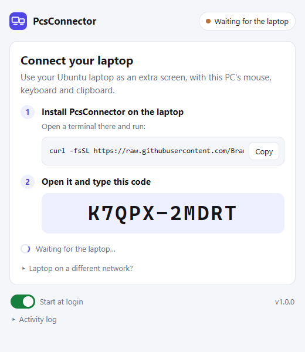
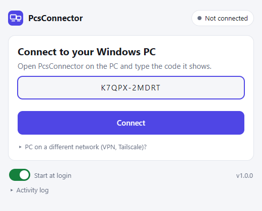
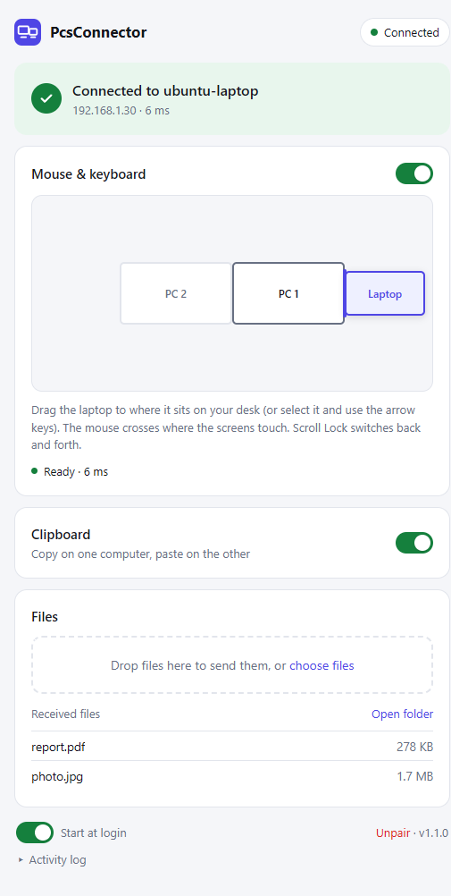

<h1 align="center">PcsConnector</h1>

<p align="center"><b>Use an Ubuntu laptop as an extra screen for your Windows PC.</b><br>
Move your PC's mouse off the edge of the screen and it carries on onto the laptop. The keyboard, clipboard and files come along too.</p>

<p align="center">
  <a href="https://github.com/Brawly0/PcsConnector/releases/latest"></a>
  
  <a href="LICENSE"></a>
</p>

<p align="center"></p>

## What it does

| | |
|---|---|
| 🖱️ **Mouse & keyboard sharing** | Push the mouse off the edge of your PC screen and it moves onto the laptop. Drag the laptop to wherever it sits on your desk: left, right, above or below any of your screens. Everything you type goes there too. Works like Input Leap or Synergy, without the setup. **Scroll Lock** switches back and forth. |
| 📋 **Shared clipboard** | Copy on one computer, paste on the other. |
| 📁 **File transfer** | Drop files into the window and they appear on the other computer. |

It is one small program on each computer (about 7 MB, about 10 MB of RAM). There's nothing extra to install on Windows, and no account or cloud: the two computers talk directly over your network, encrypted.

## Get started

It takes about two minutes. You need a Windows 10/11 PC and an Ubuntu laptop on the same network.

<table>
<tr>
<td width="50%" valign="top">

### 1. On the Windows PC

Download **[PcsConnector.exe](https://github.com/Brawly0/PcsConnector/releases/latest/download/PcsConnector.exe)** and double-click it. It shows a pairing code and the command for the laptop.

- *"Windows protected your PC"*? Click **More info → Run anyway**. (The app isn't code-signed yet.)
- Firewall prompt? Click **Allow**.

</td>
<td width="50%" valign="top"></td>
</tr>
<tr>
<td valign="top">

### 2. On the Ubuntu laptop

Open a terminal, paste this, and type your password when asked:

```bash
curl -fsSL https://raw.githubusercontent.com/Brawly0/PcsConnector/main/install/install.sh | bash
```

PcsConnector opens. **Type the code from the PC and press Connect.**

The laptop finds the PC on your network by itself, so there are no IP addresses to type.

</td>
<td valign="top"></td>
</tr>
<tr>
<td valign="top">

### 3. Done

Both windows turn green. From now on the two computers reconnect by themselves, even after a restart.

In the PC window, drag the laptop to where it sits next to your screens. Then move the mouse off that edge.

</td>
<td valign="top">
<picture>
  <source media="(prefers-color-scheme: dark)" srcset="docs/images/app-windows-dark.png">
  
</picture>
</td>
</tr>
</table>

> **Not on the same network?** Over a VPN such as Tailscale, the laptop can't find the PC by itself. On the laptop, open *"PC on a different network?"* and type one of the addresses the PC lists under *"Laptop on a different network?"*.

## Using it

- **Mouse & keyboard:** move off the edge where the laptop touches your screens (highlighted in the layout) to go to the laptop, and back to return. **Scroll Lock** jumps between them. While you're on the laptop, the PC's cursor hides. You can't cross while holding a mouse button, so dragging near the edge is safe.
- **Clipboard:** on by default; switch it off in the window.
- **Files:** drop files into the window, or use *choose files*. They arrive in the other computer's `PcsConnector/Inbox` folder.
- **Start at login** (bottom of the window): keep it on so a restart reconnects by itself.
- **Unpair** (bottom of the window): forgets the pairing. The PC then shows a new code.

**Lag tip:** the PC window shows the round trip to the laptop. Under about 20 ms feels local. If it spikes, it's almost always Wi-Fi: Ethernet or 5 GHz Wi-Fi makes the biggest difference.

## Troubleshooting

| Problem | What to do |
|---|---|
| The laptop says *"Looking for your PC…"* and never connects | Check that PcsConnector is open on the PC with the same code and that both are on the same network. If Windows asked about the firewall, it must be allowed. On a VPN, enter the PC's address instead. |
| The mouse doesn't move onto the laptop | Open the PcsConnector window on the laptop once after it starts (that's how the PC learns the laptop's screen size). Check where the laptop sits in the layout on the PC. On the laptop, `pcsc doctor` should report `/dev/uinput writable`; if not, run the installer again. |
| The PC window says *"slow path"* | The laptop's firewall blocks UDP 24800: run `sudo ufw allow 24800/udp` on the laptop. |
| The clipboard doesn't sync | Run `pcsc doctor` on the laptop. It needs `wl-clipboard` (Wayland) or `xclip` (X11), which the installer adds. |

The window's **Activity log** usually says what's wrong. On the laptop there's also `/tmp/pcsc.log`. More in [docs/SETUP.md](docs/SETUP.md).

## Requirements

- **PC:** Windows 10 or 11, 64-bit. The window uses Edge, which Windows already has, or Chrome.
- **Laptop:** Ubuntu 22.04 or newer, or another systemd-based Linux desktop. Wayland or X11, amd64 or arm64.
- **Network:** both on the same network, or connected through a VPN. Uses port 24800 (TCP and UDP).

## Privacy & security

- No accounts, no cloud, no telemetry. The computers talk only to each other.
- The pairing code is the key. Everything sent between the computers is encrypted and authenticated (AES-256-GCM, with the key derived from the code using scrypt). A computer without the code can't connect, read anything, or even get an answer when the laptop searches the network.
- The window's control page only listens on `127.0.0.1`.
- Not yet included: forward secrecy and replay protection. Use it on your own network or a VPN, and don't expose port 24800 to the internet.

## Build from source

You need [Go](https://go.dev/dl/) 1.27 or newer. On Windows run `./build.ps1`. It puts everything in `dist/`: the Windows app, a console build (`pcsc.exe`), the Linux binaries (amd64, arm64), `install.sh`, and an offline Ubuntu bundle. Run `go test ./...` for the tests.

There's also a command line: `pcsc host`, `pcsc join [address] --token CODE`, `pcsc doctor`, `pcsc version`. See [docs/SETUP.md](docs/SETUP.md) for manual installs and uninstalling, and [docs/ARCHITECTURE.md](docs/ARCHITECTURE.md) for how it works.

## License

[MIT](LICENSE)
